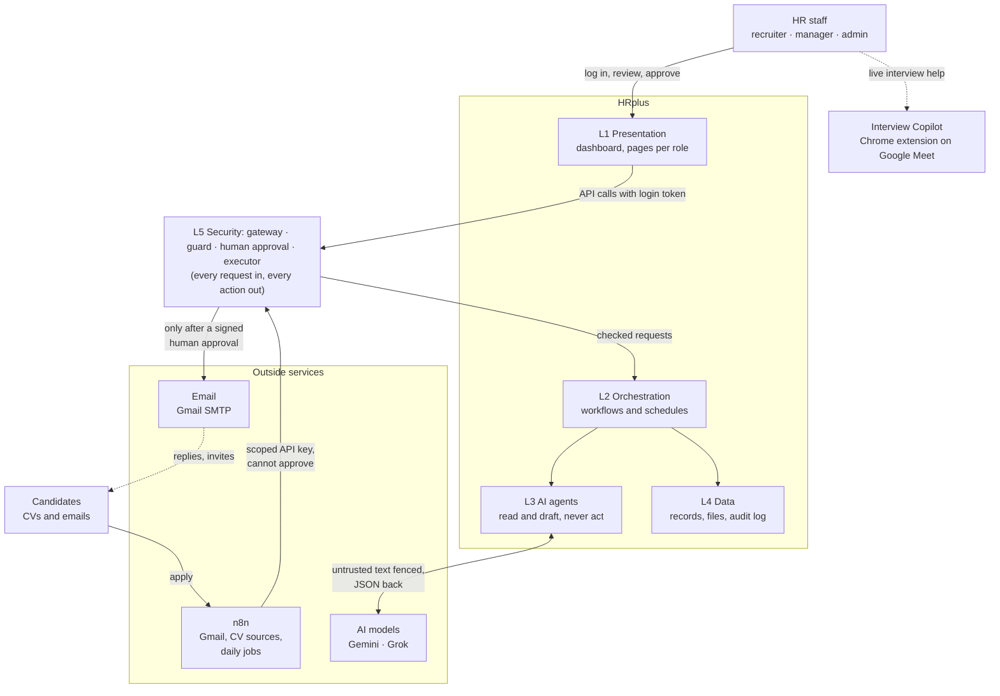

# 01 · System context: who and what connects to HRplus

**In one sentence:** HR staff use HRplus through a dashboard; candidates, emails and project files come in from
outside; every piece of the system sits in one of five layers, with security wrapped around all of them.

## How to read it
- **Only HR staff log in.** Recruiter, manager and admin each see different pages ([07 · Roles](07-roles-and-permissions.md)).
  Employees are records in the system, not users.
- **Everything from outside is untrusted:** CVs, candidate emails and uploaded project files go through the security
  layer first ([05 · AI security](05-ai-security-guardrails.md)).
- **The AI only reads and drafts.** It has no access to email or to the database. Sending anything goes through a
  human approval and then the executor, the only component that holds the email credentials
  ([02 · Human approval](02-human-approval-state-machine.md)).
- **n8n is optional.** It watches mailboxes and runs daily jobs, and calls HRplus with an API key that can never approve.
- **The Interview Copilot** is a separate Chrome extension with its own small backend ([09](09-interview-copilot.md)).

**In the code:** `dashboard/` (L1), `backend/orchestration/` and `n8n/` (L2), `backend/agents/` (L3),
`backend/data/` (L4), `backend/security/` (L5), `interview-copilot/`.
