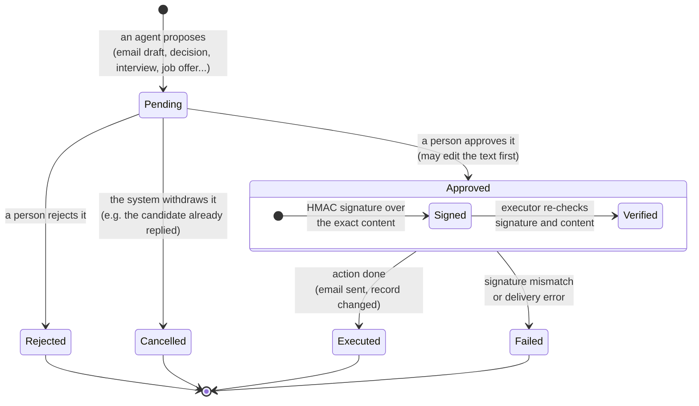
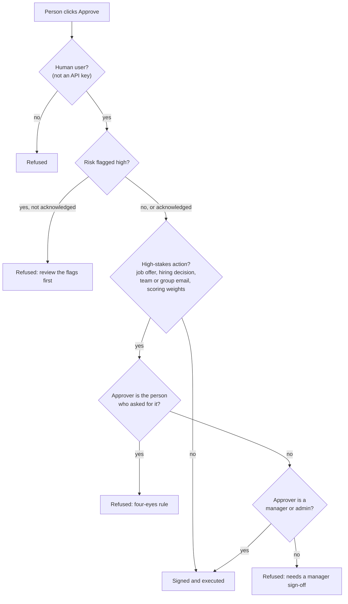
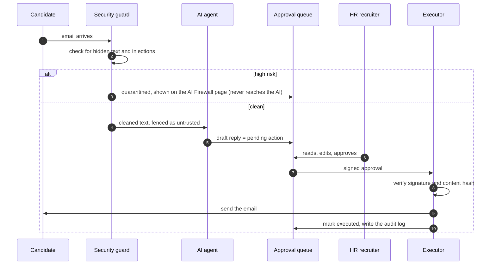

# 02 · Human approval: how an AI action waits for a person

**In one sentence:** the AI can only *propose* an action; nothing is sent or changed until a person approves it, the
approval is signed, and the executor checks that signature before doing anything.

## The life of one proposed action (state machine)

## Who may approve what (checked before signing)

## One example end to end: replying to a candidate email

## How to read it
- **Pending is the only door.** Agents can create pending actions, nothing else. Only `backend/security/executor.py`
  sends email or changes records, and only from an approved action.
- **The signature locks the content.** If anyone changes the action after it was approved, the check fails and the
  action ends as *Failed*. Nothing is sent.
- **"Approved" is a step, not a resting place:** the signed approval is stored, and the action goes straight on to
  *Executed* or *Failed*.
- **Four-eyes:** for job offers, hiring decisions, team and group emails and scoring weights, a second person must
  approve, and that person must be a manager or admin.
- **Every step is in the audit log**, which is hash-chained: editing an old entry breaks the chain.

**In the code:** `backend/orchestration/workflow.py` (propose, cancel, resume), `backend/security/executor.py`
(approve, sign, verify, execute), `backend/api/approvals.py`, dashboard page *Approvals*.
