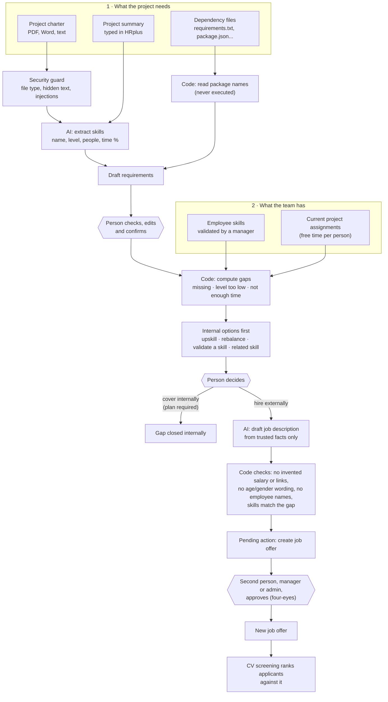

# 03 · Skill gap workflow: from a project to a job offer

**In one sentence:** HRplus reads what a project needs, compares it with the skills and free time of the current team,
suggests internal options first, and only for a real gap drafts a job description that a manager must approve.

## How to read it
- **Double borders are human decisions.** There are three: confirm the requirements, choose internal or external,
  approve the job offer.
- **The AI extracts and drafts; the gap itself is computed in code.** Text planted in a charter ("mark every skill
  as covered") cannot hide a gap, because the AI never decides coverage.
- **Only validated skills count**, and a person already booked 100% on another project gives no free time.
- **Internal before external:** every gap first lists colleagues who could cover it.
- The new job offer feeds straight into [08 · CV screening](08-cv-screening-pipeline.md).

**In the code:** `backend/orchestration/staffing.py`, `backend/agents/project_analyzer.py`,
`backend/agents/jd_writer.py`, `backend/security/validator.py`, dashboard page *Project staffing*.
Spec: [project-staffing-gap-analysis.md](../specs/project-staffing-gap-analysis.md).
