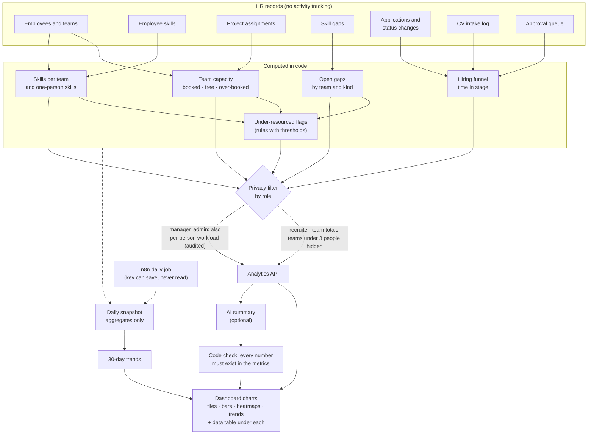

# 04 · Workforce analytics: from HR records to dashboard charts

**In one sentence:** the numbers are computed in code from records HR already keeps, filtered by what the viewer's
role may see, and drawn as charts; an optional AI summary may only repeat those numbers.

## How to read it
- **Inputs are HR records only:** skills, allocations, gaps, the hiring pipeline. Nothing measures what employees do.
- **The privacy filter sits before the API.** A recruiter never receives per-person data, and figures from teams with
  fewer than 3 people are hidden from them, because a small team's number points at one person.
- **Trends come from daily snapshots** that store totals only, so history cannot rebuild an individual record.
- **The AI summary cannot invent figures:** a sentence quoting a number that is not in the metrics is dropped.

**In the code:** `backend/orchestration/analytics.py`, `backend/api/analytics.py`, `backend/agents/insights.py`,
dashboard page *Workforce analytics*. Spec: [workforce-telemetry-analytics.md](../specs/workforce-telemetry-analytics.md).
