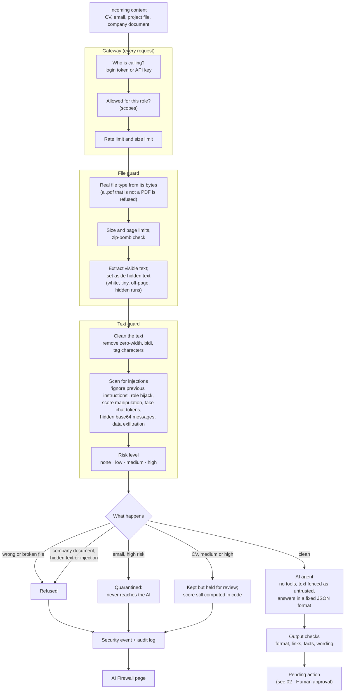

# 05 · AI security guardrails: how untrusted input is inspected

**In one sentence:** every file and message from outside passes a chain of checks before any AI reads it; anything
suspicious is held, quarantined or refused, and every catch is shown on the AI Firewall page.

## How to read it
- **Hidden text is set aside, never given to the AI.** People can still see it, so the attack is visible as evidence.
- **The guard decides what to do by source:**
  - an email with a high-risk payload is quarantined;
  - a suspicious CV is kept and held for review, because refusing it would hide the attack and could drop a genuine
    candidate;
  - a company document the HR assistant would trust is refused outright.
- **Even if an injection slips through, it cannot act.** The AI has no tools and only returns JSON. Scores are
  computed in code, and anything it drafts still waits for a human approval.
- **API keys (n8n, CV collectors) can never approve,** whatever permissions an admin tries to give them.

**In the code:** `backend/security/gateway.py`, `backend/security/guard/` (`files.py`, `sanitizer.py`,
`injection.py`), `backend/security/validator.py`, `backend/security/events.py`, dashboard page *AI Firewall*.
