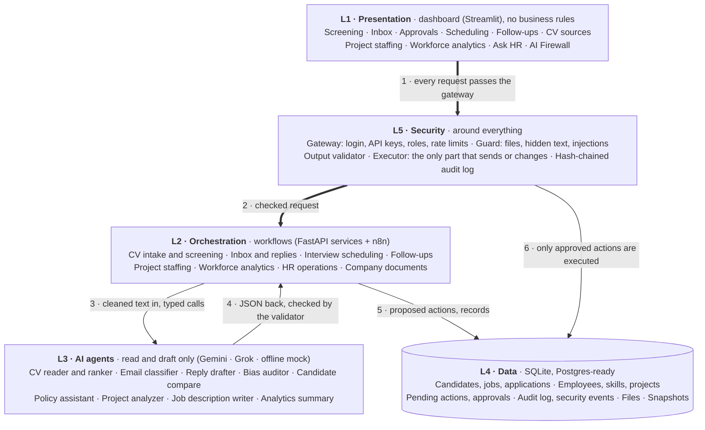

# 06 · Five-layer architecture: what lives in each layer

**In one sentence:** each layer has one job and talks only to its neighbours; security (L5) is not a layer you pass
once but a ring every request and every action goes through.

## How to read it
- **L1 has no business rules.** The dashboard only calls the API, so the same rules apply to n8n and any other client.
- **L2 runs the workflows** and is where a workflow pauses for a human (it creates a pending action) and resumes after
  the decision.
- **L3 agents have no tools.** They receive text and return JSON in a fixed format; they cannot send, save or browse.
- **L4 keeps every row tied to a company (tenant)** and uses random IDs, so records cannot be guessed or mixed.
- **L5 is on both sides of the AI:** input is inspected before the AI reads it, and output is checked before anyone
  acts on it.

**In the code:** `dashboard/`, `backend/orchestration/` + `n8n/`, `backend/agents/`, `backend/data/`, `backend/security/`.
