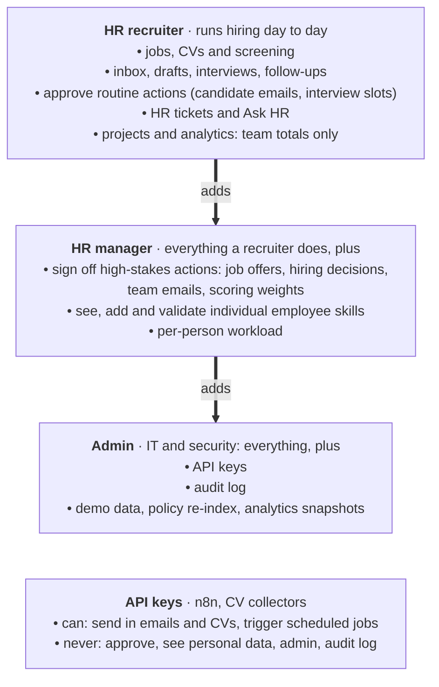

# 07 · Roles and permissions: who can do what

**In one sentence:** only HR staff log in, in three roles that build on each other; machines (API keys) can feed data
in but never approve or see personal data.

| Access | Recruiter | Manager | Admin |
|---|:-:|:-:|:-:|
| Jobs, CV upload and screening | ✅ | ✅ | ✅ |
| Inbox, candidate emails, interviews, follow-ups | ✅ | ✅ | ✅ |
| Approve routine actions | ✅ | ✅ | ✅ |
| Sign off job offers, hiring decisions, team emails, scoring weights | — | ✅ | ✅ |
| Projects, skill gaps and analytics (team totals) | ✅ | ✅ | ✅ |
| Individual employee skills and per-person workload | — | ✅ | ✅ |
| AI Firewall | ✅ | ✅ | ✅ |
| Audit log, API keys, demo data, snapshots | — | — | ✅ |

## How to read it
- **Arrows mean "adds to":** a manager can do everything a recruiter can, and an admin everything a manager can.
- **Rules on top of the roles:**
  - **Four-eyes:** the person who asks for a high-stakes action cannot approve it.
  - **Small teams stay anonymous:** recruiters don't see figures from teams under 3 people.
  - **No self-service:** nobody can change their own skill record or award themselves points.
- The same table is shown in the app: on the log-in page and under "What my role can do" in the sidebar.

**In the code:** `backend/security/gateway.py` (`ROLE_SCOPES`, `ROLE_ACCESS`), [docs/roles.md](../roles.md).
