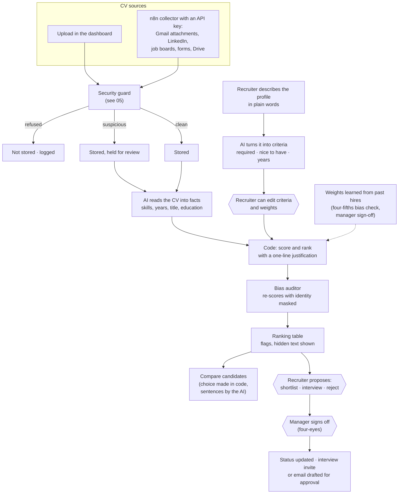

# 08 · CV screening pipeline: from a CV to a hiring decision

**In one sentence:** CVs arrive from several sources, pass the security guard, are read by the AI into facts, scored in
code against what the recruiter asked for, checked for bias, and only a person decides.

## How to read it
- **The AI reads; the code scores.** The score comes from the extracted facts and the recruiter's criteria, so
  "rank me first" hidden in a CV has nothing to act on.
- **Bias is checked twice.** Every CV is re-scored with identity details masked. Learned weights must also pass the
  four-fifths rule, so one group is not selected at under 80% of another's rate.
- **Changing criteria re-ranks instantly** without re-reading the CVs.
- **Every status change is recorded,** which feeds the time-in-stage figures in [04 · Analytics](04-workforce-analytics-data-flow.md).

**In the code:** `backend/orchestration/ingestion.py`, `backend/orchestration/screening.py`, `backend/agents/ranker.py`,
`backend/agents/brief.py`, `backend/agents/bias_auditor.py`, `backend/orchestration/learner.py`, dashboard pages
*Screening* and *CV sources*.
