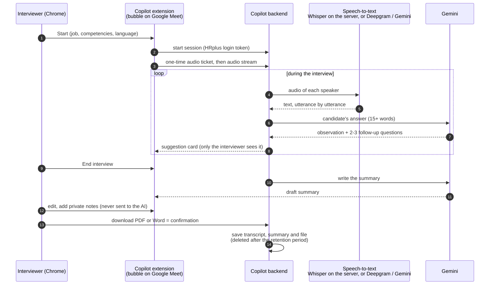

# 09 · Interview Copilot: live help during a video interview

**In one sentence:** a Chrome extension listens to a Google Meet interview, turns speech into text, suggests
follow-up questions to the interviewer only, and writes a summary that HR edits before anything is saved.

## How to read it
- **The candidate never sees the suggestions**; they appear only in the interviewer's bubble.
- **Nothing is stored while the interview runs.** The transcript stays in memory, and the interview is saved only
  when HR downloads the edited summary. Unconfirmed sessions are dropped after 12 hours, saved ones after the
  retention period (180 days by default).
- **Speech-to-text can stay on the machine** (local Whisper), so audio does not have to leave the server.
- **It reuses the HRplus login**: the same token, and only the same company can read a candidate's interviews.
- Candidate consent is collected before the interview, outside the extension.

**In the code:** `interview-copilot/extension/` (Chrome extension), `interview-copilot/backend/` (FastAPI, port 8010),
[interview-copilot/README.md](../../interview-copilot/README.md).
