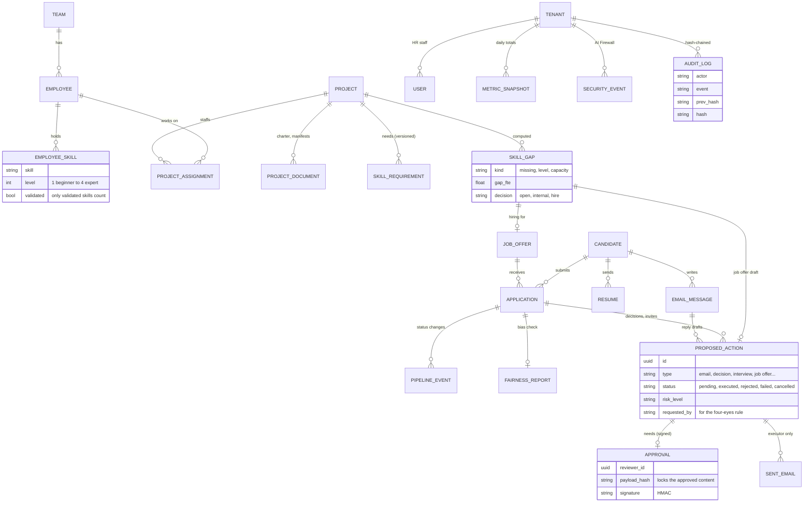

# 10 · Data model: the main records and how they connect

**In one sentence:** four groups of records (hiring, approvals, people and projects, security), all tied to one
company (tenant); approvals and the audit log connect them.

## How to read it
- **Hiring (top):** candidates, CVs, applications and every status change.
- **Approvals (middle):** a proposed action can be approved once, with a signature over its exact content. Only the
  executor creates sent emails.
- **People and projects:** employees, their validated skills and assignments, and the gaps computed from them. A gap
  marked "hire externally" leads to a job offer.
- **Security:** security events feed the AI Firewall. The audit log is hash-chained: each entry includes the hash of
  the previous one, so editing history is detectable.
- Every table also carries the company id (tenant), left out of the drawing to keep it readable.

**In the code:** `backend/data/models.py`.
