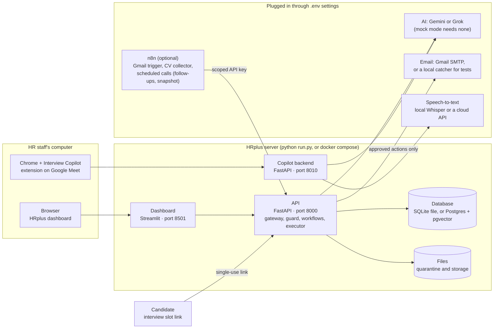

# 11 · Deployment: what runs where

**In one sentence:** one command starts the API and the dashboard on a laptop; a database, n8n, email and the AI
models are plugged in through settings, and the Interview Copilot runs next to it.

## How to read it
- **Runs offline by default.** With `LLM_PROVIDER=mock` the AI agents use rule-based stand-ins, so the whole demo
  works without any API key or internet access.
- **Email:** for tests, a local mail catcher prints every approved email. For real delivery, set Gmail with an app
  password; sent mail then appears in the Gmail Sent folder.
- **Database:** a local SQLite file by default; set `DATABASE_URL` to use Postgres (with pgvector for embeddings).
- **Candidates never log in.** The only thing they open is a single-use link to choose an interview slot.

**In the code:** `run.py`, `docker-compose.yml`, `.env.example`, `interview-copilot/backend/`.
